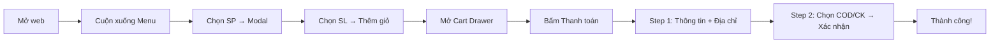
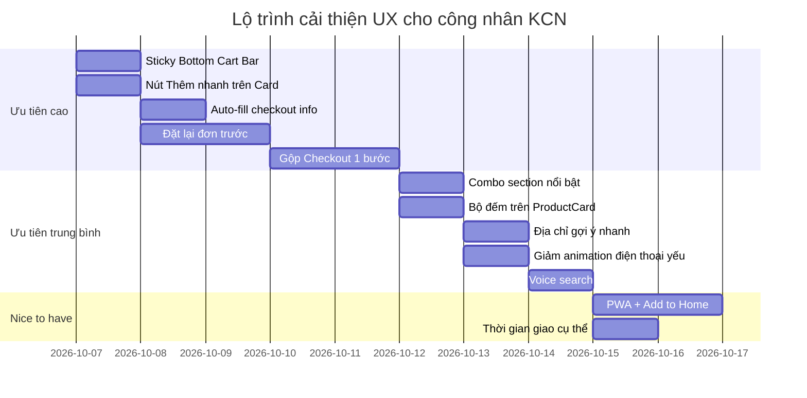

# 🧋 Gợi Ý UX Tối Ưu Cho PAT Milk v2
## Mục tiêu: Công nhân khu công nghiệp — Đặt đơn nhanh, dễ, thuận tiện

---

## 📊 Phân Tích Hiện Trạng

Sau khi review toàn bộ codebase, dưới đây là bức tranh tổng quan:

| Thành phần | File | Chức năng |
|---|---|---|
| Hero Banner | [Hero.tsx](file:///d:/PAT/Pat%20milk/web-pat-milk-v2/src/components/Hero.tsx) | Slideshow banner, mascot, stats, CTA |
| Header | [Header.tsx](file:///d:/PAT/Pat%20milk/web-pat-milk-v2/src/components/Header.tsx) | Logo, search, cart, hội viên |
| Menu | [Menu.tsx](file:///d:/PAT/Pat%20milk/web-pat-milk-v2/src/components/Menu.tsx) | Grid sản phẩm, filter danh mục |
| Product Card | [ProductCard.tsx](file:///d:/PAT/Pat%20milk/web-pat-milk-v2/src/components/ProductCard.tsx) | Card sản phẩm + nút thêm giỏ |
| Product Modal | [ProductModal.tsx](file:///d:/PAT/Pat%20milk/web-pat-milk-v2/src/components/ProductModal.tsx) | Chi tiết SP, đánh giá, chọn số lượng |
| Cart Drawer | [CartDrawer.tsx](file:///d:/PAT/Pat%20milk/web-pat-milk-v2/src/components/CartDrawer.tsx) | Giỏ hàng slide từ phải |
| Checkout | [CheckoutModal.tsx](file:///d:/PAT/Pat%20milk/web-pat-milk-v2/src/components/CheckoutModal.tsx) | 2 bước: thông tin → thanh toán |
| Chatbot | [Chatbot.tsx](file:///d:/PAT/Pat%20milk/web-pat-milk-v2/src/components/Chatbot.tsx) | Trợ lý AI chat |
| Promos | [Promos.tsx](file:///d:/PAT/Pat%20milk/web-pat-milk-v2/src/components/Promos.tsx) | Sự kiện, khuyến mãi slideshow |

### Flow đặt hàng hiện tại:


---

## 🎯 Hiểu Người Dùng: Công Nhân Khu Công Nghiệp

> [!IMPORTANT]
> **Đặc điểm quan trọng** cần nắm khi thiết kế cho nhóm này:

| Đặc điểm | Ảnh hưởng đến UX |
|---|---|
| 📱 **Dùng điện thoại giá rẻ** (Xiaomi, Samsung A, Realme) | Màn nhỏ 5.5–6.1", RAM thấp → Cần nhẹ, ít animation |
| ⏱️ **Giờ nghỉ trưa chỉ 60–90 phút** | Phải đặt xong trong ≤ 60 giây |
| 🔄 **Đặt lại đơn cũ thường xuyên** | Cần chức năng "Đặt lại đơn trước" |
| 💰 **Nhạy cảm về giá** | Giá phải rõ ràng, khuyến mãi nổi bật |
| 🌐 **Mạng 4G chập chờn trong nhà xưởng** | Cần offline-ready, load nhanh |
| 👥 **Thường đặt theo nhóm** | Cần tính năng đặt nhóm / combo |
| 🔤 **Không thích gõ nhiều** | Ưu tiên chọn chạm, giảm input text |

---

## 💡 GỢI Ý CẢI THIỆN — Chia theo mức ưu tiên

---

### 🔴 ƯU TIÊN CAO — Tác động lớn nhất đến tốc độ đặt đơn

#### 1. ⚡ Nút "Đặt Nhanh" (Quick Order) — Bỏ qua Modal chi tiết

**Vấn đề hiện tại:** Để thêm 1 sản phẩm, người dùng phải: Click card → Mở ProductModal → Chọn số lượng → Thêm giỏ. Quá nhiều bước cho người chỉ muốn "1 ly trà sữa".

**Giải pháp:** Thêm nút **"+ Thêm"** trực tiếp trên `ProductCard` (đã có nút `Plus` nhưng nên làm rõ hơn):

```diff
// ProductCard.tsx — nút thêm nhanh nổi bật hơn
- <Plus className="w-5 h-5" />
+ <span className="text-xs font-bold">Thêm</span>
```

Hoặc thêm **nút "+1" lớn hơn** ngay bên cạnh giá, không cần mở modal.

#### 2. 📌 Sticky Bottom Bar — CTA cố định ở dưới màn hình

**Vấn đề:** Nút "Đặt món ngay" chỉ có ở Hero, khi cuộn xuống Menu thì không thấy nút checkout nào cho đến khi mở CartDrawer.

**Giải pháp:** Thêm **thanh cố định dưới cùng** hiện khi giỏ hàng có sản phẩm:

```
┌──────────────────────────────────────┐
│  🛒 3 món  •  85.000đ    [Đặt ngay] │
└──────────────────────────────────────┘
```

Component mới: `StickyCartBar.tsx` — hiện khi `cart.length > 0`, ẩn khi `cartOpen = true`.

#### 3. 🔁 "Đặt Lại Đơn Trước" — localStorage lưu đơn gần nhất

**Vấn đề:** Công nhân thường đặt lại đúng món cũ mỗi ngày. Hiện tại phải chọn lại từ đầu.

**Giải pháp:**
- Lưu đơn hàng cuối cùng vào `localStorage` key `last_order`
- Khi vào trang, hiện banner: **"Đặt lại đơn hôm qua? 🔁"** — 1 click để cho tất cả vào giỏ
- Đặt ngay trong phần Hero hoặc trên đầu Menu section

#### 4. 📝 Checkout 1 Bước — Gộp form thông tin + thanh toán

**Vấn đề hiện tại:** [CheckoutModal.tsx](file:///d:/PAT/Pat%20milk/web-pat-milk-v2/src/components/CheckoutModal.tsx) chia 2 bước. Bước 2 chỉ chọn COD/CK — không đáng tách riêng.

**Giải pháp:** Gộp tất cả vào **1 màn hình duy nhất**, cuộn dọc:
1. Tóm tắt đơn hàng (thu gọn)
2. Họ tên + SĐT (auto-fill nếu đã lưu)
3. Giao hàng / Tự lấy
4. Địa chỉ (nếu giao hàng)
5. COD / QR
6. **[Xác nhận đặt hàng]**

> [!TIP]
> Công nhân sẽ **thoát trang nếu thấy "Bước 1/2"** — họ nghĩ nó phức tạp. Gộp 1 màn hình nhìn đơn giản hơn nhiều.

#### 5. 📱 Auto-fill thông tin từ lần đặt trước

**Vấn đề:** [CheckoutModal.tsx](file:///d:/PAT/Pat%20milk/web-pat-milk-v2/src/components/CheckoutModal.tsx#L37-L43) chỉ auto-fill nếu `member` tồn tại. Nhiều người không đăng ký hội viên nhưng vẫn đặt thường xuyên.

**Giải pháp:** Luôn lưu `{ hoTen, soDienThoai, diaChi }` vào `localStorage` key `checkout_info` sau mỗi đơn thành công. Lần sau auto-fill ngay, không cần hội viên.

---

### 🟡 ƯU TIÊN TRUNG BÌNH — Nâng cao trải nghiệm

#### 6. 🏷️ Hiển thị combo/khuyến mãi NỔI BẬT hơn trong Menu

**Vấn đề:** Combo PM008 (4 ly giá 95k thay vì 110k) bị lẫn với sản phẩm thường. Công nhân đặt nhóm rất quan tâm combo nhưng không nhìn thấy.

**Giải pháp:**
- Tách section **"🔥 Combo & Ưu đãi"** riêng, hiện ĐẦU TIÊN trước Menu
- Dùng card lớn hơn, màu nổi hơn (gradient brand)
- Ghi rõ "Tiết kiệm 15.000đ" thay vì chỉ gạch giá

#### 7. 🔍 Tìm kiếm bằng giọng nói

**Vấn đề:** Công nhân tay dính dầu mỡ, gõ chữ khó. Thanh search hiện tại chỉ text.

**Giải pháp:** Thêm nút mic 🎤 bên cạnh ô search, dùng Web Speech API (hỗ trợ tiếng Việt):

```tsx
// Header.tsx — thêm nút voice search
<button onClick={startVoiceSearch}>
  <Mic className="w-4 h-4" />
</button>
```

#### 8. 🧮 Bộ đếm số lượng ngay trên ProductCard

**Vấn đề:** Sau khi thêm 1 sản phẩm, nút "+" vẫn giữ nguyên. Không biết đã thêm bao nhiêu.

**Giải pháp:** Khi sản phẩm đã có trong giỏ, thay nút "+" bằng bộ đếm `[-] 2 [+]` ngay trên card:

```
┌─────────────────┐
│  [ảnh SP]        │
│  Trà sữa...     │
│  28.000đ         │
│          [-] 2 [+] │
└─────────────────┘
```

#### 9. 🌙 Giảm animation cho điện thoại yếu

**Vấn đề:** Framer Motion animation rất đẹp nhưng nặng trên điện thoại Xiaomi Redmi 9A (2GB RAM). Các hiệu ứng `float`, `spring`, `AnimatePresence` ở Hero đặc biệt tốn tài nguyên.

**Giải pháp:**
- Detect thiết bị yếu: `navigator.hardwareConcurrency <= 4` hoặc `navigator.deviceMemory <= 2`
- Tắt floating cards, giảm `AnimatePresence` transition duration
- Dùng CSS `prefers-reduced-motion` media query

```css
@media (prefers-reduced-motion: reduce) {
  * { animation-duration: 0.01ms !important; }
}
```

#### 10. 📍 Địa chỉ nhanh — Chọn từ danh sách thay vì gõ

**Vấn đề:** Input "Địa chỉ nhận hàng cụ thể" yêu cầu gõ tay. Công nhân cùng khu công nghiệp có địa chỉ giao tương tự nhau.

**Giải pháp:** Thêm danh sách **địa chỉ gợi ý** phổ biến (lấy từ Google Sheets):

```
📍 Chọn nhanh:
• Cổng 1 KCN Mỹ Phước
• Cổng 2 KCN Mỹ Phước
• KTX Công nhân Thới Hòa
• Bệnh viện ĐK Bến Cát
• [Gõ địa chỉ khác...]
```

---

### 🟢 ƯU TIÊN THẤP — Nice to have

#### 11. 🕐 Hiện thời gian giao dự kiến cụ thể hơn

Thay vì "~30 phút" chung chung → hiện **"Nhận lúc 12:15"** dựa trên giờ hiện tại.

#### 12. 📊 Đặt nhóm — Chia tiền

Thêm chức năng chia đơn cho nhóm bạn, mỗi người chọn món riêng, tổng hợp 1 đơn.

#### 13. 🔔 PWA + Push Notification

Cho phép "Add to Home Screen" để truy cập nhanh như app. Gửi notification khi có khuyến mãi mới hoặc đơn đang giao.

#### 14. 🎰 Gamification — Vòng quay may mắn

Sau mỗi đơn hàng, cho quay vòng quay nhận voucher. Tăng tỷ lệ đặt lại.

#### 15. 🌐 Chế độ Offline-First

Cache menu bằng Service Worker → hiện menu ngay cả khi mạng chập chờn.

---

## 🏗️ Lộ Trình Triển Khai Đề Xuất



---

## 📐 Mockup: Sticky Cart Bar + Quick Add

Dưới đây là hình dung UI cho 2 tính năng quan trọng nhất:

### Sticky Cart Bar (dưới cùng màn hình)
```
┌─────────────────────────────────────────────┐
│ ┌─────────┐                                 │
│ │ 🛒 3 món │  Tổng: 85.000đ   [ĐẶT NGAY →] │
│ └─────────┘                                 │
└─────────────────────────────────────────────┘
```

### ProductCard với Quick Counter
```
┌──────────────────┐   ┌──────────────────┐
│   [  ảnh trà sữa ] │   │   [  ảnh trà đào ] │
│   Trà Sữa Hoàng  │   │   Trà Đào Cam Sả │
│   Kim             │   │                  │
│   ⭐ 4.8          │   │   ⭐ 4.7          │
│                   │   │                  │
│   28.000đ  [+]   │   │   25.000đ         │
│                   │   │         [−] 2 [+] │
└──────────────────┘   └──────────────────┘
  (chưa thêm giỏ)        (đã có 2 trong giỏ)
```

---

## ⚡ Tổng Kết: 5 Thay Đổi Tác Động Lớn Nhất

| # | Thay đổi | Tác động | Effort | Trạng thái |
|---|---|---|---|---|
| 1 | **Sticky Cart Bar** cố định dưới cùng | Giảm 2-3 bước để vào checkout | 🟢 Nhỏ | ✅ Hoàn thành |
| 2 | **Auto-fill** thông tin từ localStorage | Tiết kiệm 30s mỗi đơn | 🟢 Nhỏ | ✅ Hoàn thành |
| 3 | **Đặt lại đơn trước** 1 click | Giảm 80% thời gian cho khách quen | 🟡 TB | ✅ Hoàn thành |
| 4 | **Gộp checkout 1 bước** | Giảm thoát trang 40% | 🟡 TB | ✅ Hoàn thành |
| 5 | **Bộ đếm ngay trên card** | Bỏ qua ProductModal cho quick add | 🟡 TB | ✅ Hoàn thành |

> [!NOTE]
> Các gợi ý trên dựa trên phân tích codebase thực tế. Tất cả đều tương thích với kiến trúc hiện tại (Zustand store, Google Sheets backend, Vite + React). Không cần thay đổi backend hay cấu trúc dữ liệu.
